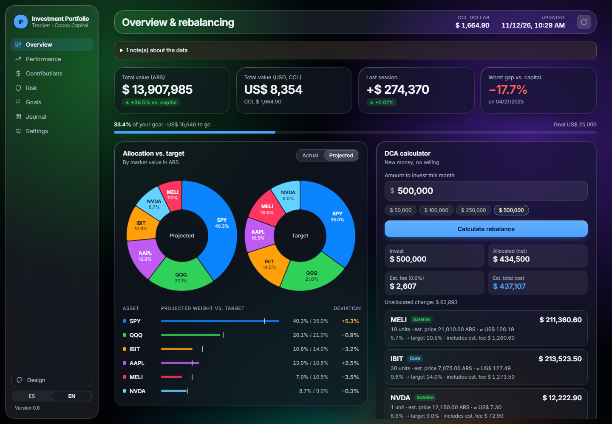
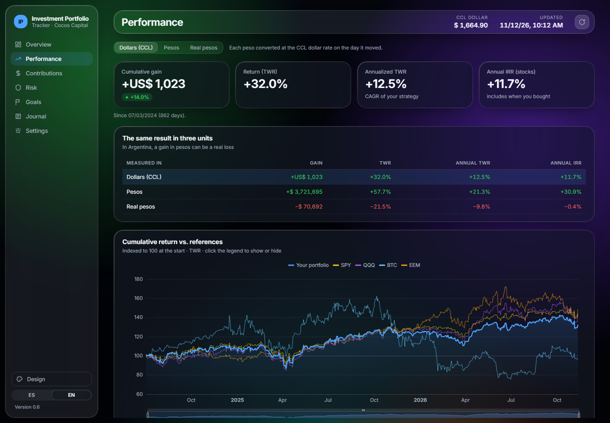
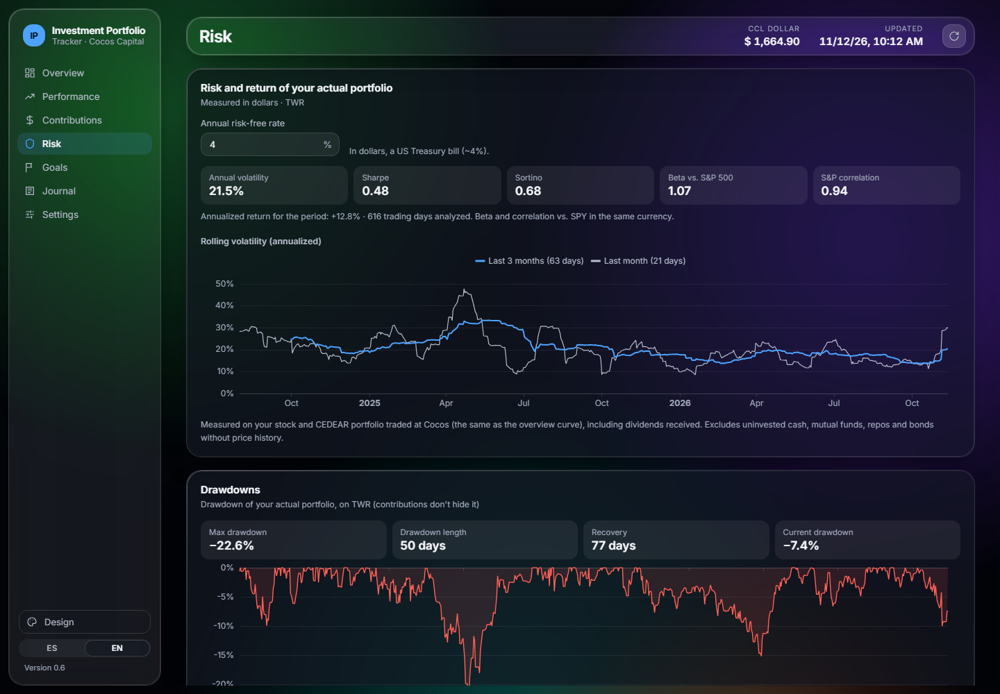
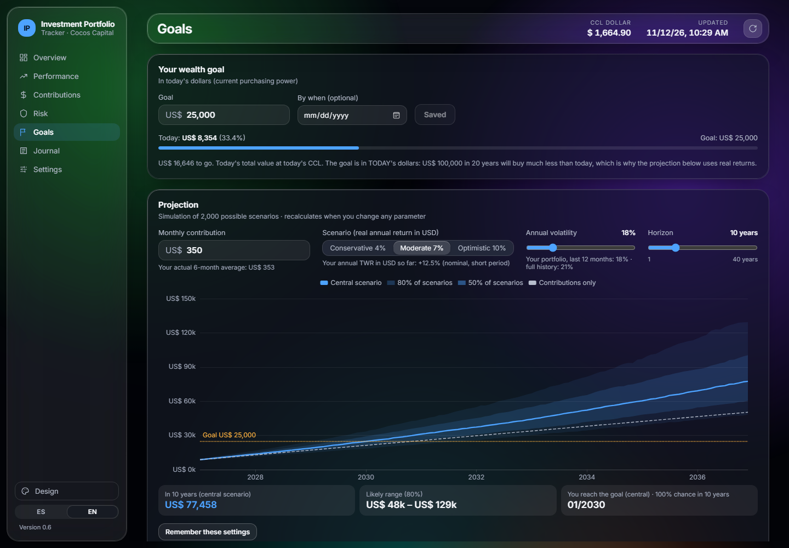
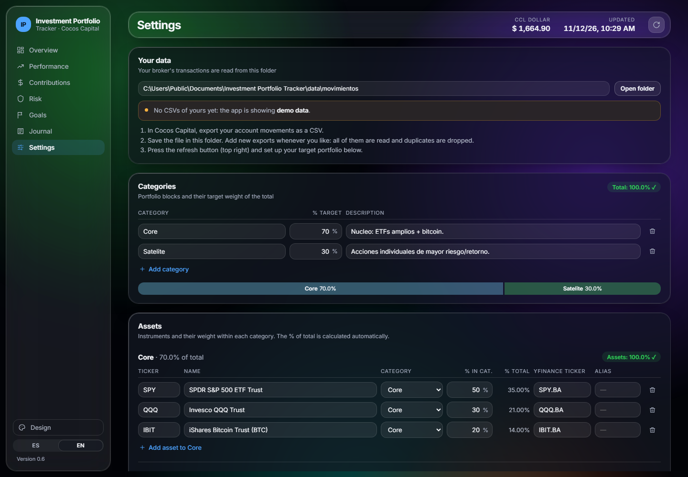

# Investment Portfolio Tracker

*[Read in English](README.md)*

Seguimiento de una cartera de inversión personal para inversores argentinos que
compran CEDEARs y acciones locales en **BYMA** a través de **Cocos Capital**.
Lee los CSV de movimientos que exportás de tu broker y te muestra todo en
pesos, en dólares (CCL) y en pesos ajustados por inflación.

**[⬇ Descargar para Windows](https://github.com/zFacuh/investment-portfolio-tracker/releases/latest)** · español e inglés · tus datos no salen de tu computadora



## Qué hace

- **Panel y rebalanceo**: tenencia actual, distribución contra tu objetivo,
  una calculadora DCA que te dice qué comprar con la plata del mes, y
  rebalanceo por banda de tolerancia.
- **Rendimiento**: TWR, TIR, benchmarks (SPY, QQQ, bitcoin...) que simulan tus
  mismos aportes, rendimiento mes a mes y contribución de cada activo.
- **Aportes y dividendos**: depósitos, retiros, racha de aportes, dividendos, y
  si tus compras le ganaron a un DCA mecánico.
- **Riesgo**: volatilidad, Sharpe/Sortino, beta, caídas, stress test contra
  crisis pasadas, concentración por sector/país/moneda y exposición real a
  través de tus ETFs.
- **Metas**: una meta patrimonial en dólares de hoy con proyección Monte Carlo.
- **Diario**: anotás por qué tomaste cada decisión y después ves si le ganó a
  no hacer nada.
- **Configuración**: tu cartera objetivo (categorías, activos, pesos) y las
  tenencias que tenés fuera del broker.

La interfaz está en **español e inglés** (se cambia abajo en la barra lateral)
y trae varios temas visuales (botón Diseño).

| Rendimiento | Riesgo | Metas |
|---|---|---|
|  |  |  |

*Las capturas usan los datos de demostración incluidos, no una cartera real.*

> Es una herramienta personal, no un consejo financiero. Los números dependen
> de datos de mercado gratuitos (Yahoo Finance) que pueden estar demorados,
> incompletos o equivocados.

## Instalación

1. Descargá `Investment-Portfolio-Tracker-<versión>-setup.exe` desde la
   [última versión](https://github.com/zFacuh/investment-portfolio-tracker/releases/latest).
2. Ejecutalo. El instalador no está firmado, así que Windows SmartScreen puede
   decir *"Windows protegió su PC"*: hacé clic en **Más información →
   Ejecutar de todas formas**.
3. Abrí **Investment Portfolio Tracker** desde el menú Inicio.

No hace falta nada más: el instalador trae todo (ni Python ni cuentas).
Windows 10/11 de 64 bits.

La primera vez vas a ver **datos de demostración** (movimientos inventados con
precios reales de mercado) y un aviso que lo dice. Después cargás los tuyos.

## Cómo cargar tus movimientos

La app reconstruye toda tu cartera (tenencia, precio promedio, capital
invertido, historia) a partir del **export de movimientos** de tu broker. Nunca
se conecta a tu cuenta del broker.



1. En Cocos Capital, exportá los movimientos de tu cuenta en formato CSV.
2. En la app, andá a **Configuración → Tus datos** y tocá **Abrir carpeta**.
   Guardá el CSV ahí. Con la app instalada esa carpeta es
   `Documentos\Investment Portfolio Tracker\data\movimientos`.
3. Tocá el botón de **actualizar** (arriba a la derecha). En cuanto esa
   carpeta tiene al menos un CSV, se dejan de usar los datos de demostración.
4. En **Configuración**, armá tu cartera objetivo (ver más abajo).

### Cuando pasan los meses

Cada export trae solo el período que elegiste, así que alcanza con ir sumando
archivos:

- Tirá cada export nuevo en la misma carpeta. Se leen **todos** los archivos y
  se juntan en una sola historia.
- No importa si los exports se pisan: las filas repetidas se descartan por su
  número de ticket (`nroTicket`).
- Para que la carpeta no se llene, la app mueve sola todos los CSV menos el más
  nuevo a una subcarpeta `procesados`, y los sigue leyendo desde ahí. Nunca
  borra nada, y vos tampoco deberías: los exports viejos son el único registro
  de los movimientos viejos.

### Formato esperado

Es el formato del export de Cocos Capital. Si usás otro broker, podés convertir
su export a esta forma.

```
nroTicket;nroComprobante;fechaEjecucion;fechaLiquidacion;tipoOperacion;instrumento;moneda;mercado;cantidad;precio;montoBruto;comision;ddmm;iva;otros;total
```

- Separador `;`, fechas `DD-MM-AAAA`, números con formato argentino (`1.234,56`).
- El ticker sale de los paréntesis al final de `instrumento`
  (`CEDEAR APPLE INC. (AAPL)` → `AAPL`).
- Valores de `tipoOperacion` que se reconocen: `Compra`, `Venta`,
  `Recibo De Cobro` (depósito), `Orden De Pago` (retiro), `Dividendos`,
  `Dividendos En Especie`, `Liquidacion Suscripcion Fci` /
  `Liquidacion Rescate Fci` (FCI), `Renta Y Amortizacion Usd` (cupones de
  bonos), y algunos ajustes de dividendos y conversión de moneda.

Hay un ejemplo completo en [`data/demo/movimientos_demo.csv`](data/demo/movimientos_demo.csv).

### Tenencias fuera del broker

Lo que tengas en otro lado (otro broker, una billetera cripto) se carga en
**Configuración → Tenencias manuales**. Se suma al valor total y se cotiza como
todo lo demás.

## Cómo armar tu cartera objetivo

En **Configuración** definís:

- **Categorías** (ej. Core 70% / Satélite 30%) y su peso sobre el total.
- **Activos**: el ticker, su categoría, su peso dentro de la categoría, y el
  símbolo de Yahoo Finance con el que se cotiza (`TSLA.BA` para un CEDEAR en
  BYMA). El *alias* opcional es otro ticker operable que cuenta como el mismo
  activo.

La calculadora DCA y las herramientas de rebalanceo usan estos objetivos. Lo
que tengas y no cargues acá aparece como *fuera de objetivo* (0% objetivo,
nunca se compra).

## Tus datos no salen de tu computadora

No hay servidor ni cuenta. Lo único que se consulta en internet son datos
públicos de mercado: cotizaciones de Yahoo Finance, el dólar CCL de
dolarapi.com, y el CCL histórico y la inflación de argentinadatos.com.

Tus archivos están en `Documentos\Investment Portfolio Tracker` (app instalada)
o en la carpeta del proyecto (si la corrés desde el código):

| Archivo | Qué guarda |
|---|---|
| `data/movimientos/*.csv` | Los exports de tu broker |
| `config/portfolio_config.json` | Tu cartera objetivo (se crea a partir de un ejemplo la primera vez) |
| `data/manual_holdings.json` | Tenencias fuera del broker |
| `config/metas.json` | Tu meta patrimonial |
| `data/diario.json` | Tu diario de decisiones |
| `config/diseno_escritorio.json`, `config/ui_prefs.json` | Tema y preferencias de pantalla |

Hacé tus propias copias de seguridad. Desinstalar la app no los borra. Desde
el código, todos están en el `.gitignore`: si hacés un fork y subís tus
cambios, ninguno se sube.

Para que la app instalada use otra carpeta (por ejemplo un repositorio clonado
que ya tiene tus datos), definí la variable de entorno `IPT_DATA_ROOT` con esa
carpeta.

## Correrla desde el código

Sirve si querés modificarla, o si preferís la versión web.

| | App de escritorio | Versión web |
|---|---|---|
| Qué es | Ventana nativa (Tauri + React) | Página de Streamlit en el navegador |
| Necesita | Python 3.10+, Node.js 22, Rust | Python 3.10+ |
| Cómo se abre | `desktop\abrir_app.bat` | `run.bat` |

Las dos usan el mismo motor en Python (`core/`) y los mismos archivos de datos.

```bash
git clone https://github.com/zFacuh/investment-portfolio-tracker.git
cd investment-portfolio-tracker
py -3 -m pip install -r requirements.txt -r desktop/backend/requirements.txt
```

- **Versión web**: doble clic en `run.bat`, o `py -3 -m streamlit run app.py`.
- **App de escritorio**: instalá [Node.js 22](https://nodejs.org/) y
  [Rust](https://rustup.rs/) (con las Visual Studio C++ Build Tools que te
  ofrece), y después doble clic en `desktop/abrir_app.bat`, o `npm install` y
  `npm run tauri dev` desde `desktop/app`.

Desde el código, tus CSV van en `data/movimientos/` dentro de la carpeta del
proyecto. `IPT_PYTHON` elige el intérprete de Python (por defecto `py -3`). El
log del motor queda en `%TEMP%\investment-portfolio-tracker-backend.log`.

### Generar el instalador

```bash
py -3 -m pip install pyinstaller
py -3 desktop/scripts/build_engine.py
cd desktop/app
npm run tauri build
```

El primer paso empaqueta el motor en Python en
`desktop/app/src-tauri/engine-dist/` para que el instalador no necesite Python.
El segundo genera el instalador en `src-tauri/target/release/bundle/nsis/`.

### Estructura del proyecto

```
core/              Motor de cálculo (Python): lectura de CSV, tenencia, rendimiento, riesgo...
desktop/backend/   API local (FastAPI) que usa la app de escritorio, en 127.0.0.1:8765
desktop/app/       Interfaz de escritorio (React + TypeScript) y ventana (Tauri / Rust)
desktop/scripts/   Empaquetado del motor en Python para el instalador
ui/, app.py        Versión web (Streamlit)
config/, data/     Cartera de ejemplo y datos de demostración (tus archivos los ignora git)
tests/             Tests del motor: py -3 -m pytest
```

## Licencia

[MIT](LICENSE)
