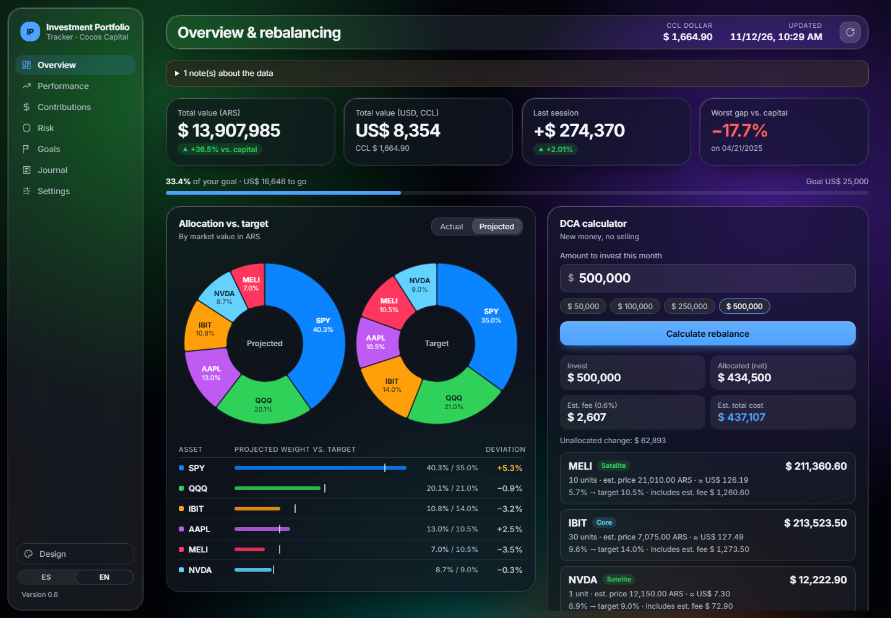
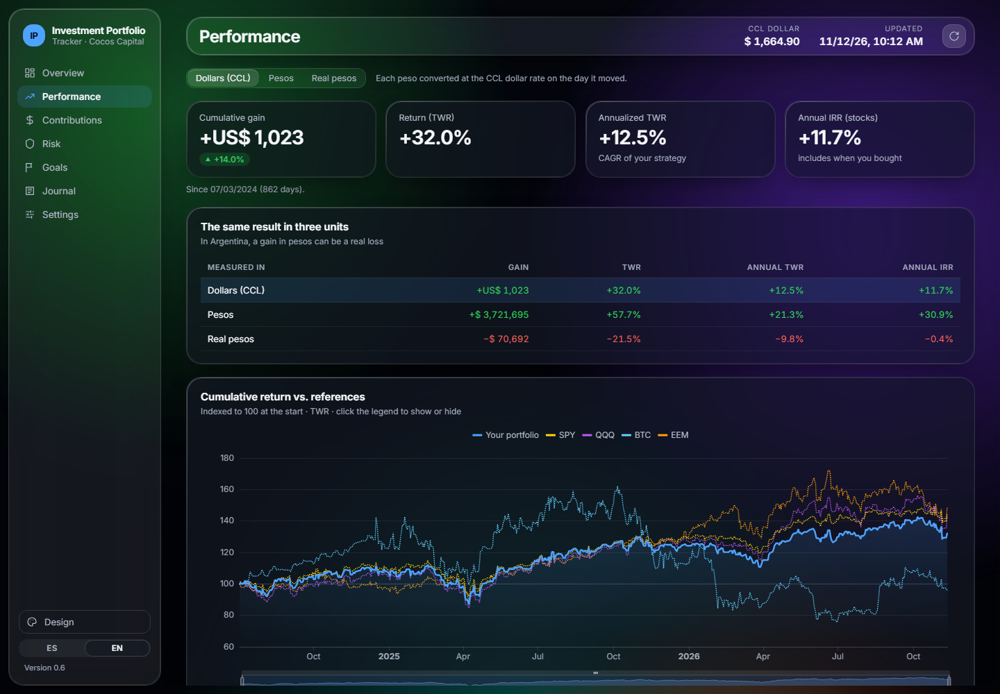
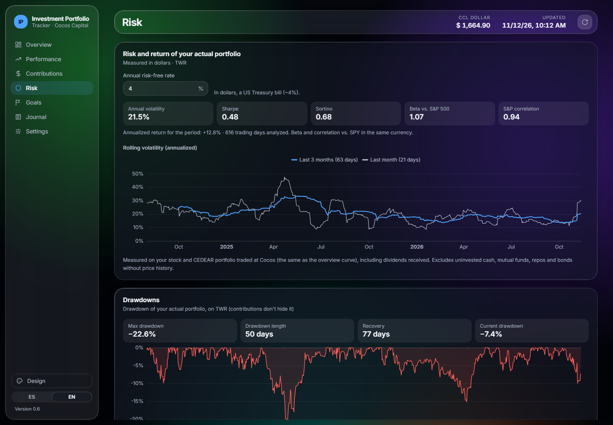
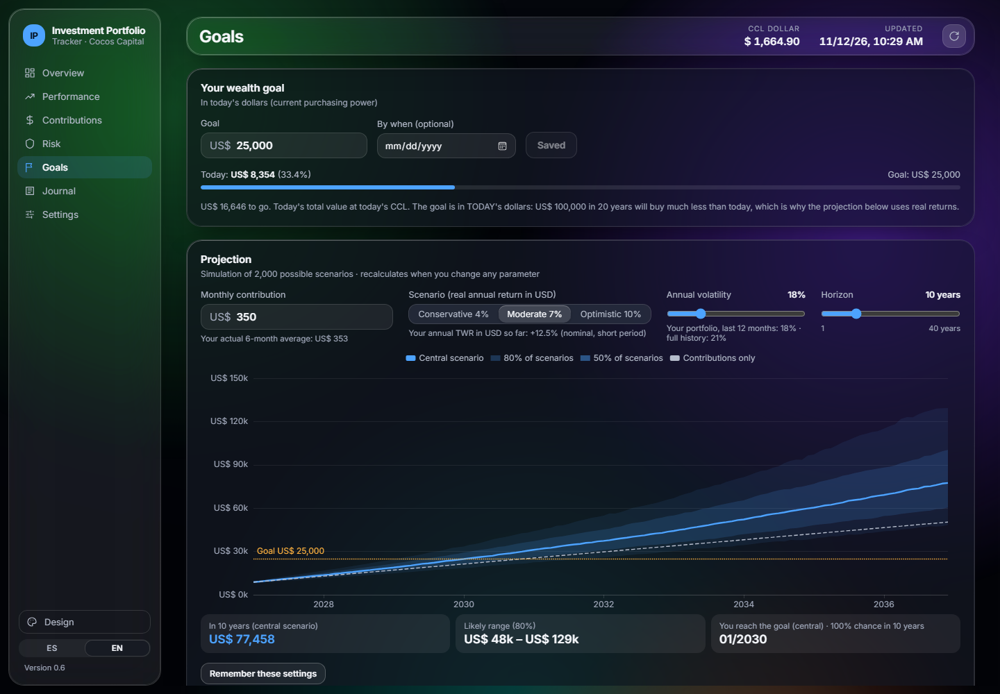
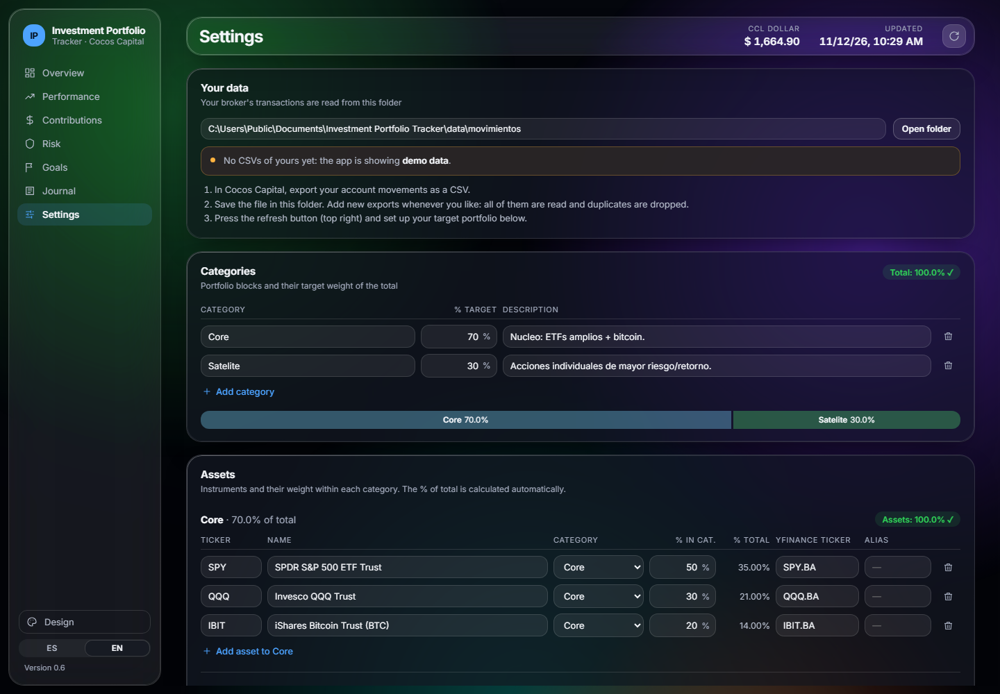

# Investment Portfolio Tracker

*[Leer en español](README.es.md)*

A personal investment portfolio tracker for Argentine investors who buy
CEDEARs and local stocks on **BYMA** through **Cocos Capital**. It reads the
transaction CSVs you export from your broker and shows everything in pesos, in
dollars (CCL) and in inflation-adjusted pesos.

**[⬇ Download for Windows](https://github.com/zFacuh/investment-portfolio-tracker/releases/latest)** · English and Spanish · your data never leaves your computer



## What it does

- **Overview & rebalancing**: current holdings, allocation vs. your target, a
  DCA calculator that tells you what to buy with this month's money, and
  tolerance-band rebalancing.
- **Performance**: time-weighted return (TWR), money-weighted return (IRR),
  benchmarks (SPY, QQQ, bitcoin...) that simulate your same contributions,
  monthly returns and per-asset contribution.
- **Contributions & dividends**: deposits, withdrawals, contribution streak,
  dividends, and whether your purchase timing beat a mechanical DCA.
- **Risk**: volatility, Sharpe/Sortino, beta, drawdowns, stress tests against
  past crises, concentration by sector/country/currency, real exposure through
  ETFs.
- **Goals**: a wealth goal in today's dollars with a Monte Carlo projection.
- **Journal**: write down why you made each decision and see later whether it
  beat doing nothing.
- **Settings**: your target portfolio (categories, assets, weights) and
  holdings kept outside your broker.

The interface is available in **English and Spanish** (switch at the bottom of
the sidebar) and comes with several visual themes (Design button).

| Performance | Risk | Goals |
|---|---|---|
|  |  |  |

*Screenshots use the bundled demo data, not a real portfolio.*

> This is a personal tool, not financial advice. Numbers depend on free market
> data (Yahoo Finance) that can be delayed, incomplete or wrong.

## Install

1. Download `Investment-Portfolio-Tracker-<version>-setup.exe` from the
   [latest release](https://github.com/zFacuh/investment-portfolio-tracker/releases/latest).
2. Run it. The installer isn't code-signed, so Windows SmartScreen may say
   *"Windows protected your PC"*: click **More info → Run anyway**.
3. Open **Investment Portfolio Tracker** from the Start menu.

Nothing else is needed: the installer includes everything (no Python, no
accounts). Windows 10/11, 64-bit.

The first time, you'll see **demo data** (invented transactions priced at real
market closes) and a notice saying so. Next, load your own.

## Load your transactions

The app rebuilds your whole portfolio (holdings, average prices, invested
capital, history) from your broker's **transaction export**. It never connects
to your broker.



1. In Cocos Capital, export your account movements (*movimientos*) as a CSV
   file.
2. In the app, go to **Settings → Your data** and click **Open folder**. Save
   the CSV there. With the installed app this folder is
   `Documents\Investment Portfolio Tracker\data\movimientos`.
3. Press the **refresh** button (top right). Once that folder has at least one
   CSV, the demo data is no longer used.
4. Still in **Settings**, set up your target portfolio (see below).

### Adding new months later

Each export only covers the period you chose, so just keep adding files:

- Drop each new export into the same folder. **All** files are read and merged
  into one history.
- Overlapping exports are fine: duplicate rows are removed by their ticket
  number (`nroTicket`).
- To keep the folder tidy, the app automatically moves every CSV except the
  newest one into a `procesados` subfolder. Those files are still read.
  Nothing is ever deleted, so don't delete them yourself either: older exports
  are the only record of older transactions.

### Expected format

This is the format of the Cocos Capital export. If you use another broker, you
can convert its export to this layout.

```
nroTicket;nroComprobante;fechaEjecucion;fechaLiquidacion;tipoOperacion;instrumento;moneda;mercado;cantidad;precio;montoBruto;comision;ddmm;iva;otros;total
```

- Separator `;`, dates as `DD-MM-YYYY`, Argentine numbers (`1.234,56`).
- The ticker is taken from the parentheses at the end of `instrumento`
  (`CEDEAR APPLE INC. (AAPL)` → `AAPL`).
- Recognized `tipoOperacion` values: `Compra`, `Venta`, `Recibo De Cobro`
  (deposit), `Orden De Pago` (withdrawal), `Dividendos`, `Dividendos En
  Especie`, `Liquidacion Suscripcion Fci` / `Liquidacion Rescate Fci` (mutual
  funds), `Renta Y Amortizacion Usd` (bond coupons), and a few dividend and
  currency-conversion adjustments.

A full example lives in [`data/demo/movimientos_demo.csv`](data/demo/movimientos_demo.csv).

### Holdings outside your broker

Assets you hold elsewhere (another broker, a crypto wallet) go in
**Settings → Manual holdings**. They're added to your total value and quoted
like everything else.

## Set up your target portfolio

In **Settings** you define:

- **Categories** (e.g. Core 70% / Satellite 30%) and their share of the total.
- **Assets**: the ticker, its category, its weight within that category, and
  the Yahoo Finance symbol used for quotes (`TSLA.BA` for a CEDEAR on BYMA).
  The optional *alias* is another ticker you can trade that counts as the same
  asset.

The DCA calculator and the rebalancing tools use these targets. Assets you hold
but didn't add here show up as *off-target* (0% target, never bought).

## Your data stays on your computer

There is no server and no account. The only network requests are for public
market data: quotes from Yahoo Finance, the CCL dollar from dolarapi.com, and
historical CCL and inflation from argentinadatos.com.

Your files live in `Documents\Investment Portfolio Tracker` (installed app) or
in the project folder (running from source):

| File | What it holds |
|---|---|
| `data/movimientos/*.csv` | Your broker exports |
| `config/portfolio_config.json` | Your target portfolio (created from an example on first run) |
| `data/manual_holdings.json` | Holdings outside your broker |
| `config/metas.json` | Your wealth goal |
| `data/diario.json` | Your decision journal |
| `config/diseno_escritorio.json`, `config/ui_prefs.json` | Theme and display preferences |

Back them up yourself. Uninstalling the app doesn't delete them. When running
from source they're all in `.gitignore`, so pushing a fork never uploads them.

To point the installed app at another folder (for example a cloned repository
that already has your data), set the `IPT_DATA_ROOT` environment variable to
that folder.

## Run from source

Useful if you want to change the code, or prefer the web version.

| | Desktop app | Web version |
|---|---|---|
| What it is | Native window (Tauri + React) | Streamlit page in your browser |
| Requires | Python 3.10+, Node.js 22, Rust | Python 3.10+ |
| Start it | `desktop\abrir_app.bat` | `run.bat` |

Both use the same Python engine (`core/`) and the same data files.

```bash
git clone https://github.com/zFacuh/investment-portfolio-tracker.git
cd investment-portfolio-tracker
py -3 -m pip install -r requirements.txt -r desktop/backend/requirements.txt
```

- **Web version**: double-click `run.bat`, or `py -3 -m streamlit run app.py`.
- **Desktop app**: install [Node.js 22](https://nodejs.org/) and
  [Rust](https://rustup.rs/) (with the Visual Studio C++ Build Tools it
  offers), then double-click `desktop/abrir_app.bat`, or `npm install` and
  `npm run tauri dev` from `desktop/app`.

From source, your CSVs go in `data/movimientos/` inside the project folder.
`IPT_PYTHON` picks the Python interpreter (default `py -3`). The engine's log is
written to `%TEMP%\investment-portfolio-tracker-backend.log`.

### Building the installer

```bash
py -3 -m pip install pyinstaller
py -3 desktop/scripts/build_engine.py
cd desktop/app
npm run tauri build
```

The first command packages the Python engine into
`desktop/app/src-tauri/engine-dist/` so the installer doesn't need Python. The
second produces the installer under `src-tauri/target/release/bundle/nsis/`.

### Project layout

```
core/              Calculation engine (Python): CSV parsing, holdings, returns, risk...
desktop/backend/   Local API (FastAPI) that the desktop app talks to, on 127.0.0.1:8765
desktop/app/       Desktop interface (React + TypeScript) and window (Tauri / Rust)
desktop/scripts/   Packaging of the Python engine for the installer
ui/, app.py        Web version (Streamlit)
config/, data/     Example portfolio and demo data (your own files are git-ignored)
tests/             Tests for the engine: py -3 -m pytest
```

## License

[MIT](LICENSE)
